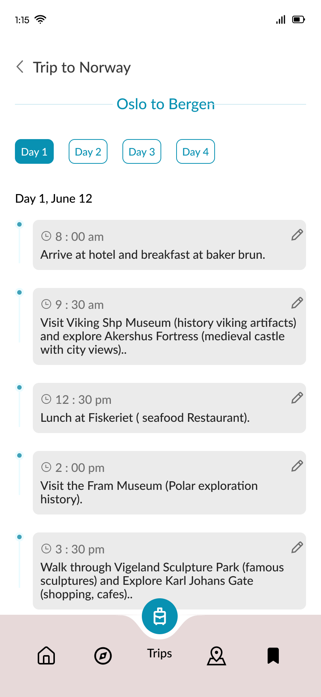
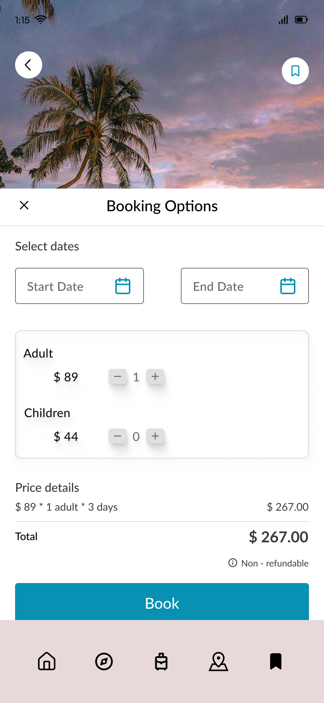

# ✈️ WANDERverse — End-to-End Travel & Itinerary Mobile App (UI/UX Design)

**Role:** UI/UX Designer  
**Tools:** Figma (Mobile UI Design, Component Library, Interactive Prototyping)  
**Platform:** iOS / Mobile Application  

🔗 **[View Live Interactive Figma Prototype](https://www.figma.com/design/OUIPkKUrt2lTtFILlJYcFK/Travel-Mobile-app?node-id=0-1&t=KNJzcHXoK7gFD1sV-1)**
📄 **[View Full UI/UX Case Study (PDF)](WANDERverse-Case-Study.pdf)**

---

## 🎯 Project Overview
**WANDERverse** is a mobile travel planning and booking application designed to unify destination discovery, day-by-day itinerary building, and ticket/accommodation checkout in one cohesive experience.

## ✨ Key User Flows & Features
* **Onboarding & Authentication:** Branded splash screens, 3-step illustrated onboarding (*Plan A Trip*, *Choose A Destination*, *Travel With Confidence*), and streamlined Login/Signup flows.
* **Destination & Event Discovery:** Searchable city guides (*Top Cities*), curated destination deep-dives (*Athens*, *Santorini*), and local event exploration (*Carnival of Prague*).
* **Interactive Trip & Itinerary Builder:** Full state-based trip management allowing users to create trips, build and edit daily itineraries, and manage saved wishlists.
* **Integrated Booking & Checkout:** End-to-end reservation flow covering date/guest selection, contact details, payment, and booking confirmation across stays, events, and transit (*Hotels* & *Buses*).

---

## 🖼️ Mobile Interface Screens

| Splash Screen | Onboarding Flow | Home Dashboard | Top Cities |
| :---: | :---: | :---: | :---: |
|  |  |  |  |

| Destination Details | Daily Itinerary Builder | Event Ticket Discovery | Stay Booking & Checkout |
| :---: | :---: | :---: | :---: |
|  |  |  |  |
